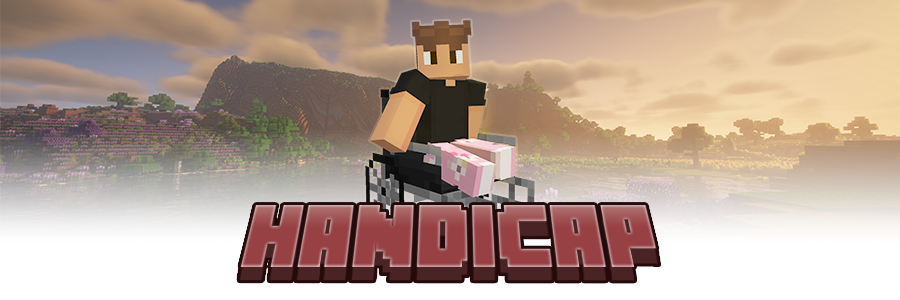

  

  <strong>Survive Minecraft with 60+ random handicaps.</strong>

  A Fabric, Quilt, NeoForge & Forge mod that makes every 10 minutes a new challenge.

---

## 

**Handicap** is a Minecraft mod that randomly assigns players handicaps at regular intervals. Survive as long as possible, adapt your playstyle, and discover all 67 unique handicaps.

You can also choose which handicaps to apply using commands, customize the timer, and decide whether handicaps stack.

> Inspired by [Disabilities](https://modrinth.com/mod/disabilities) by OddSense. Handicap is an independent implementation with its own code.
>
> ⚠️ This mod is not meant to make fun of people with disabilities. Please read the [Disclaimer](#disclaimer).

### Features

- 🎭 **67 unique handicaps** that change the way you play.
- ⏳ **A new random handicap every 10 minutes**, with stacking, max and duration all adjustable in the settings menu.
- 🔗 **Synchronization** — turn it on and every player shares the same handicaps: when one gets or loses a handicap, everyone does.
- 🎒 **Inventory panel and on-screen list** — see your handicaps, what they do and the time left. The backtick (`) key opens the settings.
- ♿ **Wheelchair** — 8 coal around an iron nugget. Place it and right-click to drive, handy with `paraplegia` or `amputated_leg`.
- 💬 **Commands** to give, clear and list handicaps.
- 💾 **Saved per world** and 🌐 **multiplayer ready** (install on client and server).

##   

By default, only **operators** can use `/handicap`, except in singleplayer where the host always can. You can change this in the config screen or in `handicap.json` (see [Configuration](#configuration)).

| Command | Description |
|---|---|
| `/handicap give <players> <handicap\|all\|random>` | Give a specific handicap, a random handicap, or all handicaps. |
| `/handicap clear` | Remove all your handicaps. |
| `/handicap clear <players>` | Remove all handicaps from selected players. |
| `/handicap clear <players> <handicap\|all\|random>` | Remove a specific handicap, a random handicap, or all handicaps. |
| `/handicap list <players>` | List the selected players' handicaps. |
| `/handicap next <players>` | Skip the timer and assign the next random handicap. |
| `/handicap settings` | Show every setting at once. |
| `/handicap settings stacking [true\|false]` | Enable or disable stacking. When disabled, a new handicap replaces the previous one. `give all` still gives every handicap. |
| `/handicap settings timer [off\|<minutes>]` | Show the timer, turn it off, or set the interval in minutes. |
| `/handicap settings max [off\|<count>]` | Limit how many handicaps a player can have. The oldest one is removed when a new one goes over the limit. Off by default. |
| `/handicap settings duration [off\|<minutes>]` | Each handicap wears off on its own after that many minutes. Off by default. |

Replace `<handicap>` with an ID from the table below.

The timer and the duration are measured in minutes. For example, `0.5` means every 30 seconds. The minimum interval is 0.1 minute (6 seconds).
 
`<players>` is a player name or a target selector such as `@s`, `@a`, `@p` or `@r`.
 
- **With operator permission**: you can use every command on any player, with or without selectors.
- **Without operator permission** (the command permission is set to *Player*, or you host a singleplayer world with cheats off): you can only target **yourself**, by typing your own player name. Selectors like `@s` and `@a` are refused by Minecraft for players who are not operators. You can still change every setting with `/handicap settings`, which applies to the whole server.

##   

| # | Handicap | ID | Effect |
|---:|---|---|---|
| 1 | Blind | `blind` | Permanent blindness. |
| 2 | Color Blind | `color_blind` | You see in black and white. |
| 3 | Deaf | `deaf` | You cannot hear anything; subtitles are enabled automatically. |
| 4 | Diabetes | `diabetes` | Sugary food hurts you when eaten. |
| 5 | Schizophrenia | `schizophrenia` | You see and hear things that aren't real. |
| 6 | Mute | `mute` | You cannot speak in chat. |
| 7 | Seizures | `seizures` | Damage, low hunger, or negative effects can trigger seizures. |
| 8 | Cancer | `cancer` | Your maximum health slowly decreases. |
| 9 | OCD | `ocd` | You must obey compulsions or you will get punish. |
| 10 | Amputated Offhand | `amputated_offhand` | Your offhand is gone. |
| 11 | Amputated Leg | `amputated_leg` | You must jump to move around. |
| 12 | Dyslexia | `dyslexia` | You can't read. |
| 13 | Short | `short` | You are smaller and your reach is shorter. |
| 14 | Dementia | `dementia` | Items move around in your inventory. |
| 15 | Asthma | `asthma` | Sprinting for too long leaves you out of breath. |
| 16 | Cerebral Palsy | `cerebral_palsy` | Random involuntary movements. |
| 17 | Narcolepsy | `narcolepsy` | You randomly fall asleep. |
| 18 | Parkinson's | `parkinsons` | Your crosshair shakes constantly. |
| 19 | Pollen Allergy | `pollen_allergy` | Nearby flowers poison you. |
| 20 | Insomnia | `insomnia` | You cannot sleep. |
| 21 | Arthritis | `arthritis` | Mining and attacking are slower. |
| 22 | Brittle Bones | `brittle_bones` | You take twice as much fall damage. |
| 23 | ADHD | `adhd` | Your selected hotbar slot changes randomly. |
| 24 | Tourette's | `tourettes` | Your camera jerks and you say random things in chat. |
| 25 | Vertigo | `vertigo` | The world randomly starts to spin. |
| 26 | Scoliosis | `scoliosis` | Your view is permanently tilted. |
| 27 | Kleptomania | `kleptomania` | You cannot drop items. |
| 28 | Lactose Intolerance | `lactose_intolerance` | Drinking milk kills you instantly. |
| 29 | Anosognosia | `anosognosia` | You cannot see your own handicaps. |
| 30 | Paraplegia | `paraplegia` | You cannot jump or sprint. |
| 31 | Reduced Mobility | `reduced_mobility` | You move more slowly. |
| 32 | Celiac Disease | `celiac` | Bread and cookies make you sick. |
| 33 | Tinnitus | `tinnitus` | A ringing noise plays from time to time. |
| 34 | Muscle Weakness | `muscle_weakness` | Your melee damage is reduced. |
| 35 | Respiratory Failure | `respiratory_failure` | You run out of air much faster underwater. |
| 36 | Hypotension | `hypotension` | Episodes of weakness and slowness. |
| 37 | Poor Circulation | `poor_circulation` | Standing still for too long slows you down. |
| 38 | Clumsiness | `clumsiness` | You sometimes drop the item in your hand. |
| 39 | Fish Allergy | `fish_allergy` | Eating fish makes you sick. |
| 40 | Claustrophobia | `claustrophobia` | Tight spaces slow you down. |
| 41 | Slow Reflexes | `slow_reflexes` | You are slowed down after taking damage. |
| 42 | Monster Phobia | `monster_phobia` | Nearby monsters weaken and slow you down. |
| 43 | Partial Deafness | `partial_deafness` | All sounds are played at half volume. |
| 44 | Inverted Vision | `inverted_vision` | Your view is flipped upside down. |
| 45 | Hiccups | `hiccups` | Random hiccups jolt your view. |
| 46 | Sneezing | `sneezing` | Sneezing fits jolt your view and slow you down. |
| 47 | Jump Curse | `jump_curse` | You jump on your own at random. |
| 48 | Magnet Feet | `magnet_feet` | You cannot jump for a moment after landing. |
| 49 | Sleepwalking | `sleepwalking` | You sometimes walk forward on your own. |
| 50 | Sticky Hand | `sticky_hand` | You cannot switch hotbar slots for a moment after switching. |
| 51 | Myopia | `myopia` | Your vision is blurry. |
| 52 | Hyperopia | `hyperopia` | The bottom third of your screen is blurry. |
| 53 | Tunnel Vision | `tunnel_vision` | Your field of view narrows to a small spot. |
| 54 | Phantom Light | `phantom_light` | Blinding flashes of light appear from time to time. |
| 55 | Spatial Disorientation | `spatial_disorientation` | Left and right are swapped. |
| 56 | Armor Intolerance | `armor_intolerance` | You cannot wear armor; it is given back when the handicap ends. |
| 57 | Drunk | `drunk` | Your movement feels unsteady. |
| 58 | Sleep Apnea | `sleep_apnea` | You sometimes wake up gasping for air and feel slow. |
| 59 | Hand Tremors | `hand_tremors` | Your hands shake and interrupt mining. |
| 60 | Visual Agnosia | `visual_agnosia` | Colors blend together, making blocks hard to tell apart. |
| 61 | Migraine | `migraine` | Migraine episodes blur and brighten the edges of your screen. |
| 62 | Broken Arm | `broken_arm` | Breaking blocks takes much longer, and your arm is in a cast. |
| 63 | Prosopagnosia | `prosopagnosia` | You can't recognize faces, mixing up all the players and mobs. |
| 64 | Derealization | `derealization` | The world turns into an unrecognizable mess. |
| 65 | Flatulence | `flatulence` | You randomly fart. |
| 66 | Stiff Neck | `stiff_neck` | You can barely look up or down. |
| 67 | Double Vision | `double_vision` | You see everything twice, slightly shifted. |

⚠️ Only one screen filter is displayed at a time, with Blind taking priority over Phantom Light, Inverted Vision, Tunnel Vision, Migraine, Color Blind, Visual Agnosia, Double Vision, Myopia, and Hyperopia. [26.1, 26.2, 1.21.1 & 1.20.1]

##   

All the settings are in one menu. Open it from the gear on the Handicap panel in your inventory, or from the mod list:

- **Fabric and Quilt**: install [Mod Menu](https://modrinth.com/mod/modmenu), then select Handicap and click *Configure*.
- **NeoForge** and **Forge**: open the *Mods* screen, select Handicap and click *Config*.

The menu has three sections:

- **Display**: how the handicap list looks on your screen. Only for you.
- **Game rules**: synchronization, stacking, timer, max, duration and disabled handicaps, saved in the world. Only players who can use `/handicap` can change them, and you need to be in a world.
- **Server config**: the command permission and the descriptions, saved in `config/handicap.json`. Only the host of a singleplayer world or an operator can change them. On a server, the menu shows the server's settings.

You can also edit `config/handicap.json` by hand (restart the game or server afterwards):
 
| Option | Values | Description |
|---|---|---|
| `permissionLevel` | `0` or `2` | `2`: only operators can use `/handicap` (default). `0`: everyone can, but without operator permission players can only target themselves. |
| `showDescriptions` | `true` or `false` | `true` (default): hovering a handicap in the inventory panel shows what it does. `false`: only the name is shown, so you have to find out the effects yourself. |
 
On a dedicated server, `handicap.json` of the server decides.

### Requirements

- Minecraft **26.1** or newer, **1.21.1** or **1.20.1** (pick the right Handicap version!)
- **Fabric** or **Quilt**: [Fabric Loader](https://fabricmc.net/) (latest version recommended) or Quilt Loader, and [Fabric API](https://modrinth.com/mod/fabric-api).
- **NeoForge** (26.x and 1.21.1): [NeoForge](https://neoforged.net/) 26.1.0.19-beta or newer for 26.x, 21.1 for 1.21.1.
- **Forge** (1.20.1): [Forge](https://files.minecraftforge.net/) 47 or newer.
- Java 25 for 26.x, Java 21 for 1.21.1, Java 17 for 1.20.1 (the official Minecraft launcher already includes the right one).

Install the mod on the **client**, and also on the **server** if you play multiplayer.

### Installation

1. 💻 Install your loader for the Minecraft version you want to play.
2. 📥 Download the Handicap mod `.jar` file (and Fabric API).
3. 📁 Place (both) `.jar` file(s) in your Minecraft `mods` folder.
4. 🚀 Launch Minecraft using your loader's profile.
5. 🎉 Enjoy my mod!

##   

Bug reports and suggestions are welcome. Please open an [issue](https://github.com/FERSPl/Handicap/issues) in this repository.

Handicap is released under the [LGPLv3 License](LICENSE).

## **Featured in**

## **Disclaimer**

This mod is not intended to make fun of or disrespect people with disabilities. I have great respect for people living with disabilities and the challenges they may face.

The purpose of this mod is entertainment, but it can also encourage curiosity and awareness about different disabilities. Like players might come across a condition they have never heard of and decide to learn more about it.

Please remember that the in-game effects are fictional gameplay interpretations and do not necessarily represent the real-life experiences of people with these conditions.
