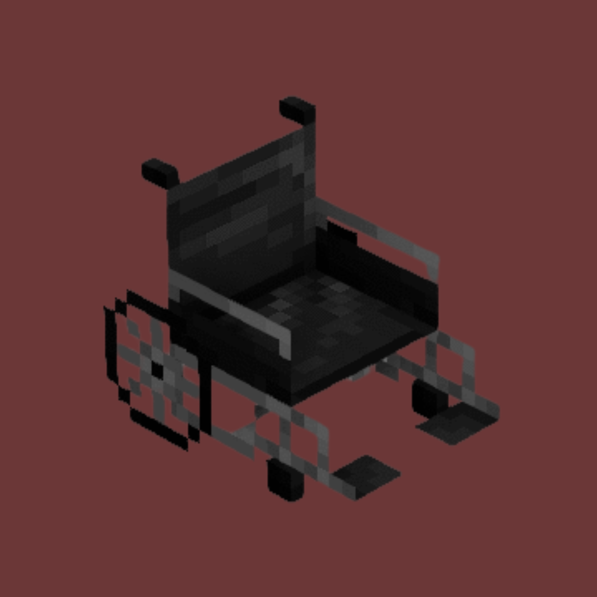

 

  

<h1 align="center">Handicap</h1>

  <strong>Survive Minecraft with 61 random handicaps.</strong>

  A Fabric mod that makes every 10 minutes a new challenge.

---

## About

**Handicap** is a Minecraft Fabric mod that randomly assigns players handicaps at regular intervals. Survive as long as possible, adapt your playstyle, and discover all 61 unique handicaps.

You can also choose which handicaps to apply using commands, customize the timer, and decide whether handicaps stack.

> Inspired by [Disabilities](https://modrinth.com/mod/disabilities) by OddSense. Handicap is an independent implementation with its own code.

## Features

- **61 unique handicaps** that change the way you play.
- **Automatic random assignment** every 10 minutes by default.
- **Customizable timer** — change the interval or turn it off entirely.
- **Commands** to give, remove, and list handicaps.
- **Stacking control** — choose whether handicaps accumulate or replace one another.
- **Persistent data** — handicaps are saved per world.
- **On-screen handicap list** — toggle it with the backtick (`) key, configurable in Controls.
- **Anosognosia** — hides your own handicap list.
- **Multiplayer support** — install the mod on both client and server for the full experience.

## Commands

**`All commands require operator permissions, except where otherwise handled by the mod.`**

| Command | Description |
|---|---|
| `/handicap give <players> <handicap\|all\|random>` | Give a specific handicap, a random handicap, or all handicaps. |
| `/handicap clear` | Remove all your handicaps. |
| `/handicap clear <players>` | Remove all handicaps from selected players. |
| `/handicap clear <players> <handicap\|all\|random>` | Remove a specific handicap, a random handicap, or all handicaps. |
| `/handicap list <players>` | List the selected players' handicaps. |
| `/handicap next <players>` | Skip the timer and assign the next random handicap. |
| `/handicap stacking [true\|false]` | Enable or disable stacking. When disabled, a new handicap replaces the previous one. `give all` still gives every handicap. |
| `/handicap timer [off\|<minutes>]` | Show the timer, turn it off, or set the interval in minutes. |

Replace `<players>` with a player name or a target selector such as `@s` or `@a`. Replace `<handicap>` with an ID from the table below.

The timer is measured in minutes. For example, `0.5` means every 30 seconds. The minimum interval is 0.1 minute (6 seconds).

## Handicaps

| # | Handicap | ID | Effect |
|---:|---|---|---|
| 1 | Blind | `blind` | Permanent blindness. |
| 2 | Color Blind | `color_blind` | You see in black and white. |
| 3 | Deaf | `deaf` | You cannot hear anything; subtitles are enabled automatically. |
| 4 | Diabetes | `diabetes` | Sugary food hurts you when eaten. |
| 5 | Schizophrenia | `schizophrenia` | You see and hear things that aren't real. |
| 6 | Mute | `mute` | You cannot speak in chat. |
| 7 | Seizures | `seizures` | Damage, low hunger, or negative effects can trigger seizures. |
| 8 | Cancer | `cancer` | Your maximum health slowly decreases. |
| 9 | OCD | `ocd` | You must obey compulsions or you lose 5 hearts. |
| 10 | Amputated Offhand | `amputated_offhand` | Your offhand is gone. |
| 11 | Amputated Leg | `amputated_leg` | You must jump to move around. |
| 12 | Dyslexia | `dyslexia` | Most text becomes harder to read. |
| 13 | Short | `short` | You are smaller and your reach is shorter. |
| 14 | Dementia | `dementia` | Items move around in your inventory. |
| 15 | Asthma | `asthma` | Sprinting for too long leaves you out of breath. |
| 16 | Cerebral Palsy | `cerebral_palsy` | Random involuntary movements. |
| 17 | Narcolepsy | `narcolepsy` | You randomly fall asleep. |
| 18 | Parkinson's | `parkinsons` | Your crosshair shakes constantly. |
| 19 | Pollen Allergy | `pollen_allergy` | Nearby flowers poison you. |
| 20 | Insomnia | `insomnia` | You cannot sleep. |
| 21 | Arthritis | `arthritis` | Mining and attacking are slower. |
| 22 | Brittle Bones | `brittle_bones` | You take twice as much fall damage. |
| 23 | ADHD | `adhd` | Your selected hotbar slot changes randomly. |
| 24 | Tourette's | `tourettes` | Your camera jerks and you say random things in chat. |
| 25 | Vertigo | `vertigo` | The world randomly starts to spin. |
| 26 | Scoliosis | `scoliosis` | Your view is permanently tilted. |
| 27 | Kleptomania | `kleptomania` | You cannot drop items. |
| 28 | Lactose Intolerance | `lactose_intolerance` | Drinking milk kills you instantly. |
| 29 | Anosognosia | `anosognosia` | You cannot see your own handicaps. |
| 30 | Paraplegia | `paraplegia` | You cannot jump or sprint. |
| 31 | Reduced Mobility | `reduced_mobility` | You move more slowly. |
| 32 | Celiac Disease | `celiac` | Bread and cookies make you sick. |
| 33 | Tinnitus | `tinnitus` | A ringing noise plays from time to time. |
| 34 | Muscle Weakness | `muscle_weakness` | Your melee damage is reduced. |
| 35 | Respiratory Failure | `respiratory_failure` | You run out of air much faster underwater. |
| 36 | Hypotension | `hypotension` | Episodes of weakness and slowness. |
| 37 | Poor Circulation | `poor_circulation` | Standing still for too long slows you down. |
| 38 | Clumsiness | `clumsiness` | You sometimes drop the item in your hand. |
| 39 | Fish Allergy | `fish_allergy` | Eating fish makes you sick. |
| 40 | Claustrophobia | `claustrophobia` | Tight spaces slow you down. |
| 41 | Slow Reflexes | `slow_reflexes` | You are slowed down after taking damage. |
| 42 | Monster Phobia | `monster_phobia` | Nearby monsters weaken and slow you down. |
| 43 | Partial Deafness | `partial_deafness` | All sounds are played at half volume. |
| 44 | Inverted Vision | `inverted_vision` | Your view is sometimes flipped upside down. |
| 45 | Hiccups | `hiccups` | Random hiccups jolt your view. |
| 46 | Sneezing | `sneezing` | Sneezing fits jolt your view and slow you down. |
| 47 | Jump Curse | `jump_curse` | You jump on your own at random. |
| 48 | Magnet Feet | `magnet_feet` | You cannot jump for a moment after landing. |
| 49 | Sleepwalking | `sleepwalking` | You sometimes walk forward on your own. |
| 50 | Sticky Hand | `sticky_hand` | You cannot switch hotbar slots for a moment after switching. |
| 51 | Myopia | `myopia` | Your vision is blurry. |
| 52 | Hyperopia | `hyperopia` | The bottom third of your screen is blurry. |
| 53 | Tunnel Vision | `tunnel_vision` | Your field of view narrows to a small spot for a while. |
| 54 | Phantom Light | `phantom_light` | Soft, gradual glows of light appear from time to time. |
| 55 | Spatial Disorientation | `spatial_disorientation` | Left and right are swapped. |
| 56 | Armor Intolerance | `armor_intolerance` | You cannot wear armor; it is given back when the handicap ends. |
| 57 | Ice Rink | `ice_rink` | The ground is as slippery as ice. |
| 58 | Sleep Apnea | `sleep_apnea` | You sometimes wake up gasping for air and feel slow. |
| 59 | Hand Tremors | `hand_tremors` | Your hands shake and interrupt mining. |
| 60 | Visual Agnosia | `visual_agnosia` | Colors blend together, making blocks hard to tell apart. |
| 61 | Migraine | `migraine` | Migraine episodes blur and brighten the edges of your screen. |

Only one screen filter is displayed at a time, with Blind taking priority over Phantom Light, Inverted Vision, Tunnel Vision, Migraine, Color Blind, Visual Agnosia, Myopia, and Hyperopia.

## Requirements

- Minecraft **26.1** or newer (pick the right Handicap version!)
- [Fabric Loader](https://fabricmc.net/) 0.19.5 or newer
- [Fabric API](https://modrinth.com/mod/fabric-api)
- Java 25 (the official Minecraft launcher already includes it)

Install the mod on the **client**, and also on the **server** if you play multiplayer. Some handicaps, such as camera shaking, sound changes, and fake noises, only work when the mod is installed on the client.

## Installation

1. Install Fabric Loader for Minecraft 26.1.
2. Download Fabric API and the Handicap mod `.jar` file.
3. Place both `.jar` files in your Minecraft `mods` folder.
4. Launch Minecraft using the Fabric profile.

## Contributing

Bug reports and suggestions are welcome. Please open an [issue](https://github.com/FERSPI/Disabilitiesmod/issues) in this repository.

## License

Handicap is released under the [MIT License](LICENSE).
